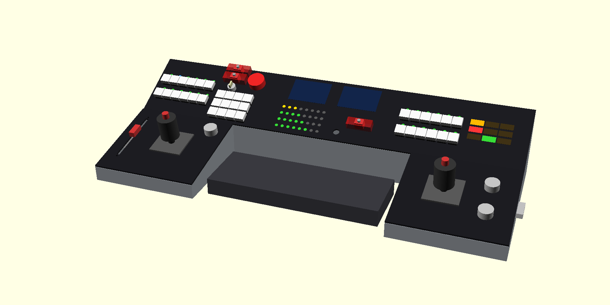
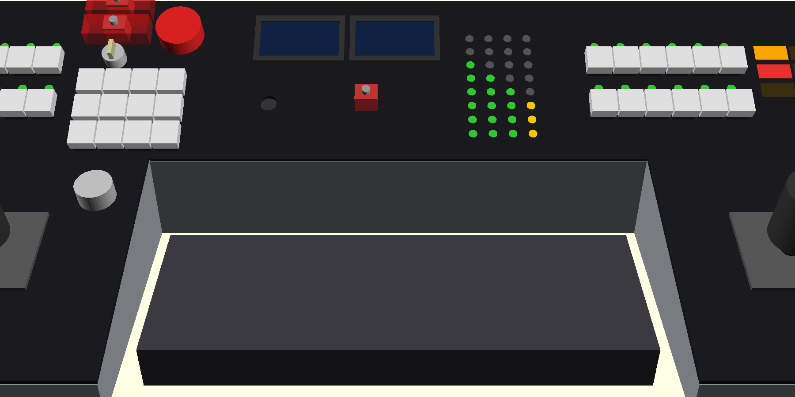
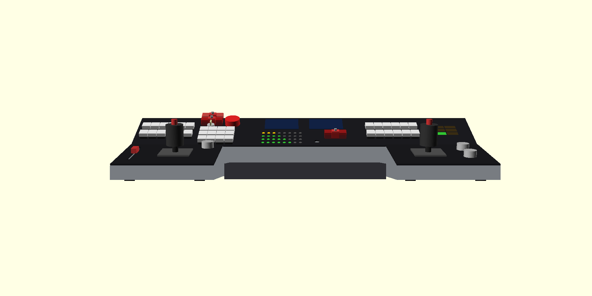
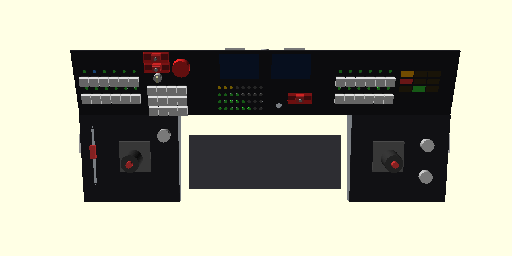
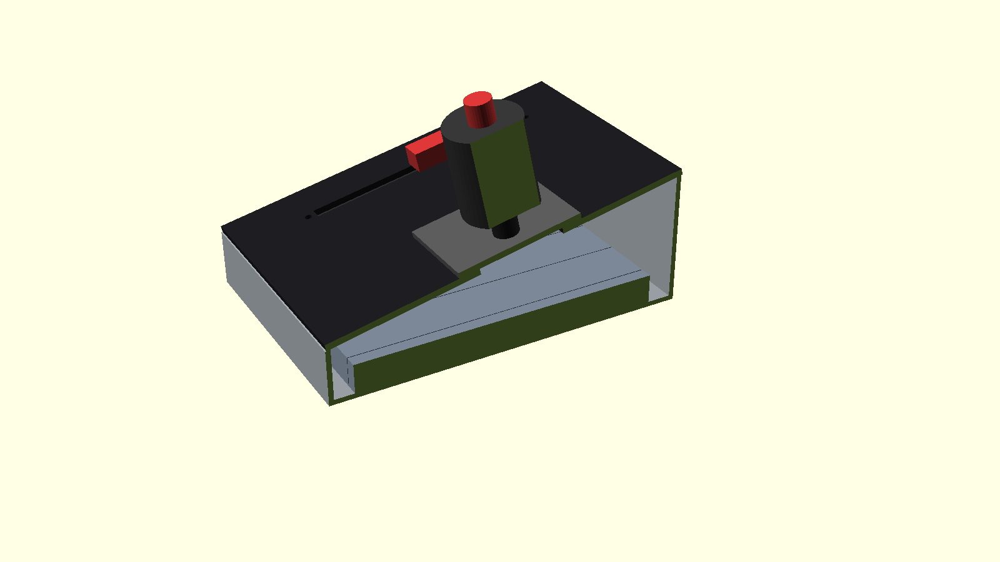
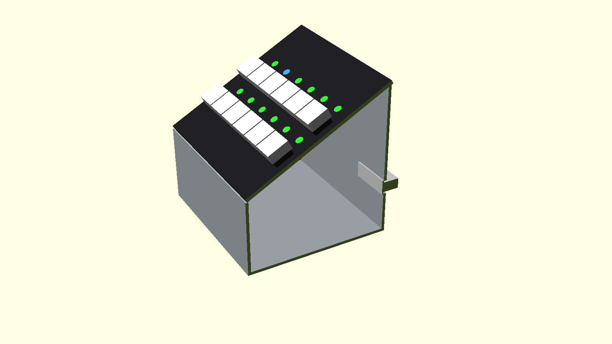
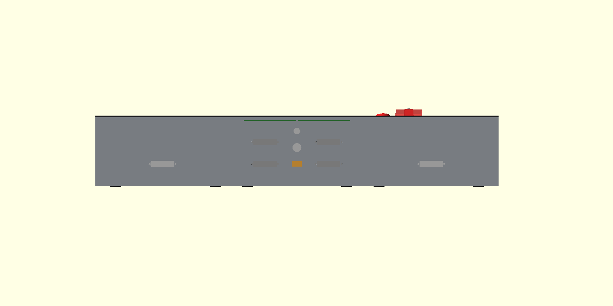
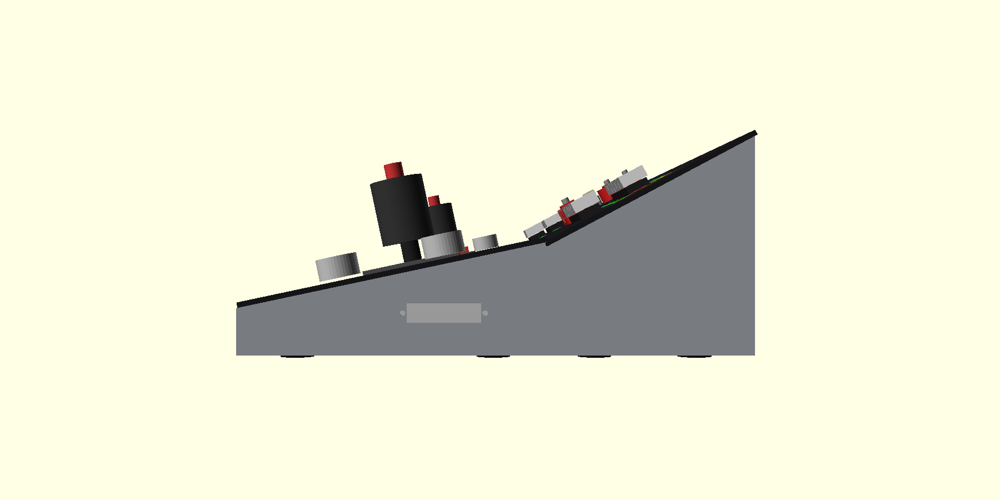

# Gallery

> **What this covers:** pictures of the console: the 3D renders now, and photos of the real build as they exist.  
> **Read it if:** you would rather look first.  
> **Status:** Renders only. There are no photos yet because nothing has been printed, ordered or built.  
> **Next:** [how it works](how-it-works.md).

## Renders (the design)

Made from [`hardware/cad/console.scad`](../hardware/cad/console.scad). Part shapes (keycaps, knobs, toggles) are simple blocks, not real models.

| | |
|---|---|
|  |  |
| The five pieces | The view from the seat |
|  |  |
| Front | Top |
|  |  |
| Inside a wing: ballast, feet, jack | Inside a strip |
|  |  |
| Rear: the cable jacks | Side: the tilt |

## Wiring pictures

The generated [wiring diagrams](../hardware/electronics/wiring/wiring.md) are drawings, not photos, but they are the nearest thing to a map of the inside.

## Build photos

None yet. Planned first photos, in the order they will happen:

- [ ] The test plate print, with a switch and a light fitted
- [ ] The parts as delivered, with the joystick on a ruler
- [ ] The first soldered DB25 jack
- [ ] One wing shell printed
- [ ] The first board on the bench, wired and powered
- [ ] The console running in KSP

To add one: put the file in `docs/photos/`, keep it under about 1 MB, name it with the date and what it shows
(`2026-11-03-test-plate-fitted.jpg`), and link it here and from the [journey](journey.md) entry it belongs to. Photos teach more than renders.
