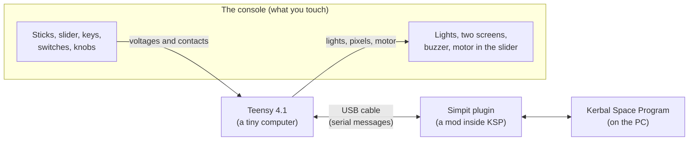
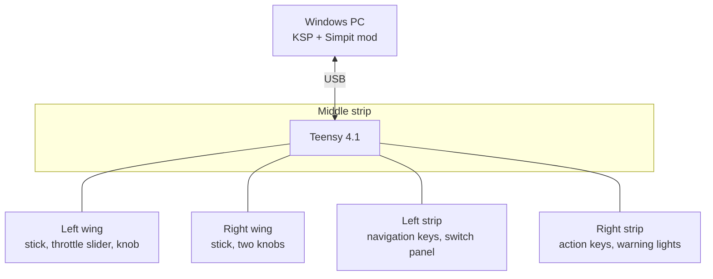
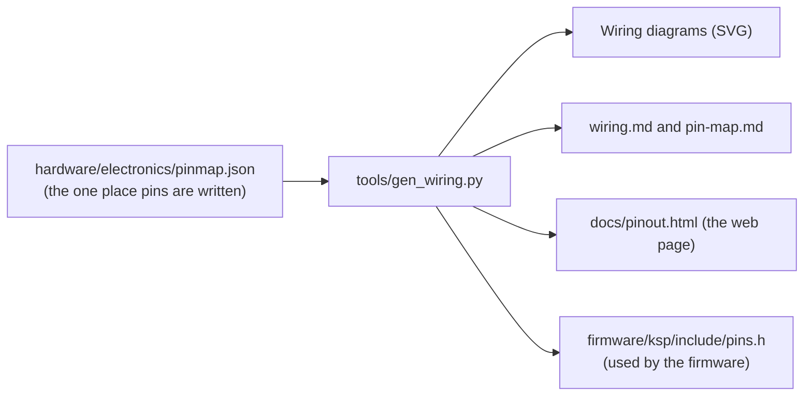

# How it works

> **What this covers:** the whole system in one page and one picture, with no jargon.  
> **Read it if:** you have never built a game controller, or you want the map before the details.  
> **Status:** Planned. This is the design; nothing is built yet.  
> **Next:** the [glossary](glossary.md), then the [journey](journey.md).

## The idea

Kerbal Space Program (KSP) is a game where you build and fly rockets. Normally you fly with a keyboard and mouse. This
project replaces most of that with real hardware: sticks to steer, a slider for the engine throttle, keys for autopilot
modes, guarded switches for ABORT and STAGE, and lights and screens that show what the game is doing.

## The signal path

Read it left to right for **input**: you move a stick, the Teensy measures it, packs it into a small message, and sends it
down the USB cable. The Simpit plugin running inside the game unpacks the message and tells KSP "rotate this way".

Read it right to left for **output**: the game says "fuel is low" or "SAS is on", the plugin forwards that, and the Teensy
lights the right pixel, draws on a screen, sounds the buzzer or drives the motor that moves the throttle slider to match the game.

That is the entire system. Everything else in the repo is the detail of one of those boxes.

## The four layers

| Layer | What it is | Where in the repo |
|---|---|---|
| **The shell** | Five 3D printed pieces holding every control at the right angle and position | [hardware/cad](../hardware/cad/README.md), [mockup](../hardware/mockup/README.md) |
| **The electronics** | The parts, and the wires that join each control to the Teensy | [parts](../hardware/sourcing/parts.md), [wiring](../hardware/electronics/wiring/wiring.md) |
| **The firmware** | The program on the Teensy that reads controls and talks to the game | [firmware](../firmware/README.md) |
| **The game side** | The Simpit mod (and one resource mod) installed in KSP | [decisions](design/decisions.md), [firmware architecture](firmware/architecture.md) |

## How the pieces connect

The console is five printed pieces, but it has only **one brain**: the Teensy in the middle strip. The other four pieces
(two wings, left strip, right strip) hold controls and nothing else. Each is joined to the middle strip by one fat cable
with 25 wires (a "DB25" cable), and the whole console has one USB cable to the PC plus one wall adapter for the lights.

Why one brain and long cables, instead of a small computer in every piece? It means one program to write and one USB link to
debug. The trade-off is a lot of wires. See [why not X?](design/why-not.md).

## How the repo's files relate (and why you can trust the diagrams)

The pin assignment is the single most error-prone fact in a build: if the wiring diagram says a stick goes to pin 14 and the
firmware reads pin 15, nothing works. So the pin assignment is written down **once**, in a data file, and scripts generate
everything that depends on it:

The parts list works the same way: `parts-shortlist.json` and `amazon-items.json` are the data, and `tools/parts.py` writes
`parts.md` from them. Files made this way say **generated** at the top. Do not edit those by hand: edit the data, then run
`make` (see [getting started](getting-started.md)). `make check` fails if a generated file is out of date.

## Follow one part through the repo

Pick a control and you can follow it from shopping list to code:

| Control | Chosen in | Bought as | Drawn in the CAD | Wired in | Firmware name |
|---|---|---|---|---|---|
| Left joystick | [decisions: Joysticks](design/decisions.md) | [parts.md](../hardware/sourcing/parts.md), SaiDian JH-D400X-R4 | `stick_proxy` in `hardware/cad/console.scad` | [left wing diagram](../hardware/electronics/wiring/wiring.md#left-wing) | `pin::L_STICK_X`, `L_STICK_Y`, `L_STICK_Z` in `pins.h` |
| Throttle slider | [decisions: Throttle](design/decisions.md) | parts.md, Adafruit 5466 plus L9110H driver | left wing in `console.scad` | left wing diagram | `pin::FADER_WIPER`, `FADER_PWM_A`, `FADER_PWM_B` |
| Action-group keys | [decisions: Key bank](design/decisions.md) | parts.md, switches and keycaps | `key_proxies` in `console.scad` | strip diagrams | `pin::ROWS`, `pin::COLS` |
| ABORT toggle | [decisions: Switch panel](design/decisions.md) | parts.md, AITRIP guarded toggles | `guard_proxy` in `console.scad` | [switch panel diagram](../hardware/electronics/wiring/wiring.md#switch-panel) | expander pin PA0 (no Teensy pin) |
| Warning lights | decisions: Switch panel and annunciator | parts.md, WS2812B pixels | `ann_pos` in `console.scad` | strip diagrams | `pin::PIXEL_DATA` |
