# Wiring diagrams

Colour-coded wiring for the five-piece console, in the same style as the goodnight-device diagrams. Nothing is built yet and none of this has been checked on real hardware: treat it as the plan to wire from. The pin tables are in [pin-map.md](pin-map.md), the checklist in [wiring-checklist.md](wiring-checklist.md), and [pinout.html](pinout.html) is the same page for a browser. Generated by `docs/tools/gen_pinout.py`.

## The five pieces

The middle strip holds the Teensy and everything that is not a switch. Each wing sits in front of an outer strip piece, so its jack is on the wing's outer end wall and its cable runs round the back. The Teensy is powered over USB only; the 5 V adapter feeds the pixels, the level shifter and the fader driver.

## Teensy 4.1

Each used pin is drawn in the wire colour of its signal, with a grey tag showing where it goes: a DB25 port and pin (LW, RW, LS, RS) or a device in the middle strip. Wires aren't drawn between the Teensy and the ports, because forty of them would cross; use the tags and the pinout grid below. <strong>The physical pin order is from memory and unchecked</strong>: compare it with <a href="https://www.pjrc.com/store/teensy41.html">PJRC&rsquo;s pinout card</a> before wiring. All pins are 3.3 V only.

## The four DB25 ports

Standard DB25 numbering. All four middle jacks are alike, and the pins are laid out so a cable in the wrong port does no damage: ground and 5 V sit on the same pins everywhere, and everything the Teensy drives (matrix rows, pixel data, fader PWM) is on pins 15&ndash;23, which any module that does not use them leaves open. COL0&ndash;5 appear on both strip ports and join in the middle piece.

## Left wing

The left wing: stick, throttle fader with its driver, and the time-warp encoder.

## Right wing

The right wing: rotation stick and two encoders.

## Strip left

Strip left: the key matrix (rows 0 and 1), two toggles and 12 pixels.

## Strip right

Strip right: the key matrix (rows 2 and 3), two toggles and 12 pixels.

## Switch panel

All sixteen inputs live on one panel and one chip. The expander sits right behind the panel, so only its I&sup2;C lines (SDA, SCL), the interrupt and 3V3 cross the DB25 cable to the Teensy. Fit 4.7 k&Omega; pull-ups on SDA and SCL at the Teensy end. Buttons are MX switches with blank DSA caps; the guarded ABORT and ENGAGE / DISENGAGE toggles, the STAGE key switch and the big STAGE button are separate parts.

## Strip middle

The two OLEDs share the SPI clock, data, DC and reset lines and have a chip-select each. The pixel chain starts at the level shifter: its output goes through a 330&ndash;470 &Omega; resistor to the left strip (LS pin 17), comes back on LS pin 18 into the 32 fuel-bar pixels here, and leaves for the right strip on RS pin 17.

## Power

The Teensy takes power over USB; the 5 V adapter feeds only the pixels, the level shifter and the fader driver, with its ground joined to the Teensy's. The master switch cuts the 5 V rail only, so the Teensy and the expander stay alive. Size the fuse just above the capped load (about 3&ndash;4 A) and cap brightness in firmware.

## Wire colours

The same signal is the same colour at both ends of its wire. Red is always 3V3, black is always GND, orange is always 5 V.

| Signal | Colour | Note |
|---|---|---|
| 3V3 | red | pots, buzzer module and OLEDs: from the Teensy |
| 5V | orange | pixels, level shifter, fader driver |
| GND | black | everything; drawn with a light edge so it shows |
| Stick X / Y / twist | purple | X purple, Y grey, twist brown: both sticks |
| Fader wiper | green |  |
| Fader touch, every push switch and toggle | white | to ground |
| Encoder A / B | blue | A blue, B yellow |
| Fader PWM A / B | pink | A pink, B teal |
| Matrix rows / columns | green | rows green, columns blue |
| Pixel data | pink | in and out |
| OLED SCK / MOSI / DC / RES / CS | yellow | yellow, blue, grey, teal, green (CS2 purple) |
| Buzzer I/O | brown |  |
| Expander SDA / SCL / INT | purple | SDA purple, SCL grey, INT teal |

## Teensy pins

| Teensy pin | Signal | Goes to |
|---|---|---|
| 0 | OLED_RES | OLEDs |
| 1 | PIXEL_DATA | chain, LS 17 |
| 2 | FADER_PWM_A | LW 22 |
| 3 | FADER_PWM_B | LW 23 |
| 4 | FADER_TOUCH | LW 12 |
| 5 | L_STICK_BTN | LW 8 |
| 6 | L_ENC_A | LW 9 |
| 7 | L_ENC_B | LW 10 |
| 8 | L_ENC_SW | LW 11 |
| 9 | R_STICK_BTN | RW 8 |
| 10 | OLED_CS1 | OLED 1 |
| 11 | OLED_MOSI | OLEDs |
| 12 | OLED_DC | OLEDs |
| 13 | OLED_SCK | OLEDs |
| 14 (A0) | L_STICK_X | LW 3 |
| 15 (A1) | L_STICK_Y | LW 4 |
| 16 (A2) | L_STICK_Z | LW 5 |
| 17 (A3) | FADER_WIPER | LW 6 |
| 18 | EXP_SDA | LS 10 |
| 19 | EXP_SCL | LS 11 |
| 20 (A6) | R_STICK_X | RW 3 |
| 21 (A7) | R_STICK_Y | RW 4 |
| 22 (A8) | R_STICK_Z | RW 5 |
| 23 | R_CAM_SW | RW 11 |
| 24 | OLED_CS2 | OLED 2 |
| 25 | BUZZER | buzzer |
| 26 | R_CAM_A | RW 9 |
| 27 | R_CAM_B | RW 10 |
| 28 | ROW0 | LS 15 |
| 29 | ROW1 | LS 16 |
| 30 | ROW2 | RS 15 |
| 31 | ROW3 | RS 16 |
| 32 | COL0 | LS+RS 3 |
| 33 | COL1 | LS+RS 4 |
| 34 | COL2 | LS+RS 5 |
| 35 | COL3 | LS+RS 6 |
| 36 | COL4 | LS+RS 8 |
| 37 | COL5 | LS+RS 9 |
| 38 | R_PAGE_A | RW 12 |
| 39 | R_PAGE_B | RW 14 |
| 40 | R_PAGE_SW | RW 19 |
| 41 | EXP_INT | LS 12 |
