# First power-up (bring-up)

> **What this covers:** a step-by-step, beginner-first procedure for switching the electronics on for the first time without breaking anything.  
> **Read it if:** the parts have arrived and you are about to wire or power a piece. Read it *before* you solder, not after.  
> **Status:** Planned. Written from the datasheets and the [wiring checklist](wiring/wiring-checklist.md); nothing here has been done on real hardware yet.  
> **Next:** [firmware](../../firmware/README.md), which you need for the tests in phases 5 and 6.

"Bring-up" means turning a new circuit on in small, checked steps, so that when something is wrong you know which step
broke it. The cheap mistakes (a stray strand of wire, power backwards) are caught by a meter before they cost a part.
Go slowly. **Never skip to the next phase because the previous one "probably" passed.**

## What you need

| Item | Why |
|---|---|
| A multimeter with a continuity (beep) mode and a DC volts range | Every check below uses it |
| The 5 V adapter and the USB cable, **unplugged** | You will add them one at a time |
| A magnifier or a phone camera in macro | To inspect joints |
| A notebook (or the checklist ticked in the repo) | Write down what you measured |
| A spare DB25 jack and some scrap wire | To practise soldering the cups |

Safety: a hot iron, fumes (ventilate), and a supply that can deliver 4 A, which is enough to melt a thin wire. The 5 V rail has a fuse
for this reason. Do not defeat it.

## The order, at a glance

Power goes in this order, one source at a time: **USB first, then the 5 V rail, then each outer piece.** If a step fails, stop,
fix it, and repeat the whole phase.

## Phase 1: Look (nothing connected)

- [ ] Hold each board under good light. Look for solder bridges between neighbouring pins, joints that look like a ball
  rather than a smooth cone (a "cold" joint), and loose strands of wire.
- [ ] Check every polarised part: the diodes (the stripe marks the cathode), the chips in their sockets (notch matches the socket),
  and the capacitors.
- [ ] Check each DB25 jack: each used pin has its wire, and nothing touches its neighbour.

## Phase 2: Meter, nothing powered

Adapter and USB **both unplugged**, and every outer piece unplugged. Set the meter to continuity.
This phase is the same as "Before first power-up" in the [checklist](wiring/wiring-checklist.md); here are the reasons.

| Test | How | You should get | If wrong |
|---|---|---|---|
| 5 V rail to GND | one probe on each | **No beep** | A short. Look for a stray strand or a swapped wire |
| 3V3 to GND | same | **No beep** | Same |
| 5 V to 3V3 | same | **No beep** | The two rails touch. Find where |
| Two neighbouring pins on each DB25 jack | probe each pair | **No beep** | A solder bridge between pins |
| Each wire from a jack to its destination | one probe at each end | **Beep** | A missing or cold joint |
| Each key, pressed and released | across its row and column | Beep only **while pressed** | A swapped row and column, or a diode in backwards |
| Each key, the other way round | probes reversed | No beep either way when released; pressed beeps one way only | A diode missing or backwards |

If you get a beep where you should not, stop. Powering a short can destroy parts.

## Phase 3: USB only

1. Plug in only the **USB cable**, from the PC to the Teensy (through the panel's USB extension, once fitted).
2. The computer should see the Teensy as a new USB device. If it does not, or anything gets warm, unplug and go back to phase 2.
3. Measure 3.3 V between the Teensy's 3V3 pin and ground. Then measure 3.3 V at each thing it powers (the stick pots, the buzzer, the displays).
   About 3.3 V is right. A reading near 5 V or near 0 V is a fault.
4. Load the simplest possible program (blink the LED) with [PlatformIO](../../firmware/README.md). If the upload works, the Teensy and the USB path are good.

## Phase 4: The 5 V rail

1. **Check the panel jack's polarity before wiring it.** With the adapter plugged into the jack and nothing else connected, put the meter on
   DC volts: the centre pin must read **+5 V** to the outer. Red and black wire colours prove nothing, only the meter does.
2. Wire jack, then the master power switch, then the fuse, then the 5 V rail with its large capacitor. The Teensy is **not** powered from this rail.
3. Meter in continuity again: still no short from 5 V to GND with the switch on.
4. Plug in the adapter with **all outer pieces unplugged** and the master switch on. Measure the rail: about 5 V (above 4.5 V is fine).
5. The fuse should hold, and nothing should get warm. If anything smells, switch off and unplug.

## Phase 5: One outer piece at a time

Do this for each of the four outer pieces (left wing, right wing, left strip, right strip), one at a time, with the previous one **unplugged**
if you have any doubt. Start with the right wing, which has the fewest conductors (14), and work up.

1. Plug in the piece's DB25 cable. A cable in the wrong port does no damage by design, but nothing will work, so use the labelled ports.
2. Run the test program for that piece (to be written: see below) and watch the readings.
3. What "working" looks like:

| Piece | Test | Good | Bad |
|---|---|---|---|
| Wings | Move the stick through its whole range | Each axis changes smoothly, and returns to the same centre value | An axis jumps or is stuck (pot not on 3V3, no ground) |
| Left wing | Move the slider by hand; then let the motor move it | Reads 0 to 100% smoothly; motor moves one way then the other | Runs backwards (swap its two motor wires), is jerky or draws too much current |
| Wings | Turn each encoder, press it | Counts up one way and down the other, one count per click | Counts jump or double (swap or debounce) |
| Left strip | Press each key and the switches on the panel | Each press registers once and only its own | Two keys fire together (a diode problem) |
| Strips | Pixels | Light in the chain order | Stops partway (a break in the chain darkens everything after it) |
| Middle | Displays and buzzer | Image appears. Buzzer makes a sound when driven | White or blank screen, or a continuous tone you cannot stop. Do the buzzer bench test in [decisions](../../docs/design/decisions.md) first |

4. Measure the 5 V rail with the piece running. It should not sag below about 4.5 V.
5. Only when the piece works, leave it plugged in and start the next.

> **Gap:** the test programs for this phase are not written yet. They are the first firmware to write (see [firmware architecture](../../docs/firmware/architecture.md)). Until then, use a bare sketch that prints raw pin readings over USB.

## Phase 6: With the game

1. Install KSP's Simpit mod and the Alternate Resource Panel mod (both via CKAN) and set the serial port in Simpit's settings. See the
   [KerbalSimpitRevamped](https://github.com/Simpit-team/KerbalSimpitRevamped) documentation for the current steps.
2. With the console connected, start KSP and check in order: a stick moves the craft, the throttle slider follows the game, a SAS key lights its pixel when the mode is on.
3. Test **ENGAGE / DISENGAGE** first. With it disengaged, move every stick and the throttle: nothing should happen in the game.

## If something goes wrong

| Symptom | Likely cause |
|---|---|
| An axis jumps or reads nonsense | A device with no ground, a pot on 5 V instead of 3V3, or a loose joint |
| A key sticks or two keys fire together | A swapped row and column, or a missing or backwards diode |
| All pixels dark | The 5 V rail is off (master switch), the level shifter has no 5 V, or the first pixel's data wire is broken |
| Pixels after one point are dark | A break in the chain at that point |
| Pixels flicker or the Teensy misbehaves when the fader moves | The motor drags the 5 V rail down or disturbs the ground. Check the capacitors and wire thickness |
| Nothing works on one piece only | Its cable is in the wrong port, or its jack has a bad joint (re-run phase 2 on it) |

Write down what you find. A fault and its fix is a good entry for the [journey](../../docs/journey.md).
