# Wiring checklist

Companion to the wiring diagrams in [wiring.md](wiring.md) (also as [pinout.html](../../../docs/pinout.html) for a browser). Pin numbers and signal names are in
[pin-map.md](pin-map.md). Nothing is built yet and none of this has been checked on real hardware: tick a box
only after you have checked it on the actual part.

Five pieces: two wings and three strip pieces. The **middle strip** holds the Teensy, the 5 V input and
everything that is not a switch. Each of the four outer pieces has one DB25 cable to it.

## Wire colours

Red is always 3V3, black is always GND, orange is always 5 V. The same signal is the same colour at both ends
of its wire. A colour can repeat when the wires never sit side by side; inside a piece the pin labels settle
which is which.

| Signal | Colour | Where |
|---|---|---|
| 3V3 | red | pots, buzzer module, TFTs: from the Teensy |
| 5 V | orange | pixels, level shifter, fader driver |
| GND | black | everything |
| Stick X | purple | both sticks |
| Stick Y | grey | both sticks |
| Stick twist | brown | both sticks |
| Fader wiper | green | left wing |
| Fader touch, push switches, toggles | white | to ground |
| Encoder A | blue | all three encoders |
| Encoder B | yellow | all three encoders |
| Fader PWM A / B | pink / teal | left wing, to the driver |
| Matrix rows | green | strips |
| Matrix columns | blue | strips |
| Pixel data | pink | strips and middle |
| TFT SCLK / MOSI / DC / RES | yellow / blue / grey / teal | middle |
| TFT chip select 1 / 2 | green / purple | middle |
| Buzzer I/O | brown | middle |
| Expander SDA / SCL / INT | purple / grey / teal | left strip |

Pink and teal are not in a basic Dupont set. Use striped wire or tape a coloured band on instead.

## Teensy pins

- [ ] **Check the physical pin order** against [PJRC's pinout card](https://www.pjrc.com/store/teensy41.html) before wiring. The order in `pinout.html` is from memory.
- [ ] All pins are 3.3 V only. Nothing at 5 V ever touches a Teensy pin.
- [ ] The Teensy is powered **only over USB**. Do not connect the 5 V rail to its VIN pin.
- [ ] Wire the Teensy side of each DB25 jack as in the pinout grid (pins 15 to 23 are the pins the Teensy drives).
- [ ] Pins 18 and 19 are the I2C bus (SDA, SCL) for the switch-panel expander, with 4.7 kΩ pull-ups to 3V3 at the Teensy end. Pin 41 is the expander's interrupt.

## Middle strip

- [ ] 5 V adapter plugs into the panel jack. **Check the jack's polarity with a meter** (centre pin should be +) before wiring it: red and black leads do not prove which is which.
- [ ] Jack, then the master power switch, then a fuse just above the capped load (about 3 to 4 A), then the 5 V rail with a 1000 µF capacitor across it. The switch cuts the 5 V rail only, so the Teensy and expander stay powered over USB.
- [ ] 74AHCT125: input from Teensy pin 1, its output enable pin tied to ground, VCC on 5 V, then 330 to 470 Ω to the left strip's data pin (LS 17). Tie the unused buffer inputs to ground.
- [ ] 32 fuel-bar pixels: data in from LS 18 (the return from the left strip), data out to RS 17. 5 V and GND straight from the rail with short wires.
- [ ] Both TFT displays on 3V3 (the DFR0669 states no logic level). Share SCLK, MOSI, DC and RES; one chip select each (pins 10 and 24). Tie BL to VCC. Leave MISO, the touch pins and SDCS unconnected.
- [ ] Buzzer module on **3V3**, I/O to pin 25. At 5 V its transistor may not switch off.
- [ ] SDA, SCL and the interrupt go to the left-strip jack (pins 10, 11, 12), with 3V3 on pin 2.
- [ ] Four **female** DB25 panel jacks on the middle strip, one per outer piece. All four are alike, so label them LW, RW, LS and RS. Each outer piece gets a **male** jack.

## Wings

Left wing (DB25 LW, 19 conductors):

- [ ] Stick: three pot wipers (X, Y, twist) to pins 3, 4, 5, top button to pin 8, pot ends to 3V3 (pin 2) and GND. **Check the stick's pin order on the real unit.**
- [ ] Fader: wiper to pin 6, high end to 3V3, low end to GND, touch pad on the nubbin to pin 12.
- [ ] L9110H next to the motor: 5 V on pins 20 and 21 (two conductors in parallel), PWM A to pin 22, PWM B to pin 23, return on pins 24 and 25. A 47 µF capacitor across its supply. Outputs to the fader's two motor pins; swap them if it runs backwards.
- [ ] Time-warp encoder: A to pin 9, B to pin 10, push to pin 11, common to GND.

Right wing (DB25 RW, 14 conductors):

- [ ] Stick as above: X, Y, twist on pins 3, 4, 5, button on pin 8, pot ends on 3V3 and GND.
- [ ] Camera encoder: A pin 9, B pin 10, push pin 11. Page encoder: A pin 12, B pin 14, push pin 19. Commons to GND.
- [ ] Leave pins 20 to 25 open.

## Strips

Left strip (DB25 LS, 21 conductors) and right strip (DB25 RS, 16 conductors):

- [ ] Every key has a diode: **anode to its column, cathode to its row**. Left strip carries rows 0 and 1, right strip rows 2 and 3. Both carry all six columns, on pins 3, 4, 5, 6, 8, 9.
- [ ] Rows are on pins 15 and 16 of both strip jacks. They are rows 0 and 1 for the left strip and rows 2 and 3 for the right strip, which the Teensy side of each jack handles.
- [ ] Pixels: data in on pin 17. The left strip's last pixel returns on pin 18 (the right strip has no return). 330 to 470 Ω in the data line at the first pixel on the left strip. 5 V on pins 20 and 21, GND on 24 and 25. Optional 100 µF across 5 V in each strip. The right strip has 21 pixels in its chain: 12 under the keys and 9 behind the annunciator windows.

### Switch panel (left strip)

- [ ] One MCP23017 expander behind the panel. SDA, SCL, INTA and 3V3 to the DB25 LS pins 10, 11, 12 and 2, ground to pins 1, 7, 13. Mirror both interrupt ports onto INTA.
- [ ] MCP23017-E/SP in a DIP-28 socket on perfboard: A0, A1, A2 tied to GND (address 0x20), RESET through 10 kΩ to 3V3, 0.1 µF across its supply. Confirm the address with a bus scan before wiring switches.
- [ ] Sixteen inputs, one wire each to its pin, the other leg of every switch to GND (internal pull-ups, no resistors): PA0 ABORT, PA1 STAGE key switch, PA2 STAGE, PA3 throttle FULL, PA4 throttle CUT, PA5 MAP, PA6 focus previous, PA7 focus next, PB0 quicksave, PB1 quickload, PB2 precision, PB3 pause, PB4 UI hide, PB5 ENGAGE / DISENGAGE, PB6 and PB7 spare.
- [ ] Thirteen small buttons are MX switches with blank DSA caps; ABORT and ENGAGE / DISENGAGE are the guarded toggles, the STAGE key switch arms STAGE, and STAGE is the big button. Ten of the small buttons are used, plus two spares. ENGAGE / DISENGAGE turns the sticks and throttle live or ignored in firmware.

### Annunciator (right strip)

- [ ] Nine pixels, one behind each 24 x 12 mm window, after the 12 key pixels in the chain. Windows: low fuel, low power, overheat, low altitude, stable orbit, atmosphere, chute safe, link, controls (lit while engaged). Give each window its own light-tight cell so the colours do not bleed.

## Soldering the DB25 jacks

Eight ITT Cannon jacks (four ZDB25S female in the middle strip, four ZDB25P male on the outer pieces; the order has four spares of each for practice) have **solder cups** with
very little room between them. Only the pins in use are wired: 19 on the left wing, 14 on the right wing, 21 on the left strip
and 16 on the right strip, the same again at the middle jack, so about 140 cup joints in all. Nothing here has been tried yet.

- [ ] **Practise first** on a spare jack or a scrap connector before the real ones.
- [ ] **Wire:** use thin stranded wire for the signal pins. Cut-off Dupont jumpers (about 26 AWG) fit a cup far better than 22 AWG, which barely goes in. Trial-fit one wire in a cup before you start, since I have not measured the cup bore.
- [ ] **Power pins:** pins 20 and 21 (5 V) and the grounds carry the most current. Put two thin wires in the same cup, or use 22 to 24 AWG with the strands flattened.
- [ ] **Prep each wire:** slide about 10 mm of small heat shrink on first, strip 3 to 4 mm and tin the strands.
- [ ] **Pre-tin each cup** with a small drop of solder and a little flux. Clamp the jack with the cups facing up.
- [ ] **Solder:** a fine chisel tip, heating the cup and not the wire, until the solder flows around the strands. Do not leave the iron on a cup: the plastic softens and the pin can move.
- [ ] **Alternate pins** (every second one, then the rest) so heat does not build up between neighbours, and let the plastic cool.
  Do one row completely, starting with the 1 to 13 row (the far row when the cups face you), then the 14 to 25 row. The order per jack
  is below and is drawn in the diagram underneath. The same order works at both ends of a cable: the pin numbers are the same, and
  only the left-to-right layout is mirrored between the male and female jack.
- [ ] **Slide the heat shrink** over each joint and shrink it, so a stray strand cannot touch its neighbour.
- [ ] **Pin numbers:** the numbering seen from the solder side is the mirror image of the mating face. Confirm each wire's pin number with a continuity test from the matching cable end before assembling anything.
- [ ] **After each jack:** no beep between any two adjacent pins, and each wire beeps from its cup to the right pin on a mating plug.
- [ ] **If the first jack is painful,** the alternative is a crimp D-sub (crimp socket housings and contacts plus a crimp tool). It would need the cutout and mounting re-checked.

Solder order for each jack (pin numbers as on the pin map; the first group in each cell, then the rest):

| Jack | 1 to 13 row | 14 to 25 row |
|---|---|---|
| Left wing (19 pins) | 1 3 5 7 9 11 13, then 2 4 6 8 10 12 | 20 22 24, then 21 23 25 |
| Right wing (14 pins) | 1 3 5 8 10 12, then 2 4 7 9 11 13 | 14, then 19 |
| Strip left (21 pins) | 1 3 5 7 9 11 13, then 2 4 6 8 10 12 | 15 17 20 24, then 16 18 21 25 |
| Strip right (16 pins) | 1 4 6 8 13, then 3 5 7 9 | 15 17 21 25, then 16 20 24 |

## Cables

- [ ] Four straight-through shielded DB25 cables, 1 m, female to male (Phoenix Contact 1656291). The male end goes into a middle jack and the female end onto an outer jack. Coil the slack; the cables run outside, behind the console.
- [ ] Ground each cable's shield at the **middle** end only. The datasheet's circuit diagram lists the shield at both heads, so it is joined to both shells inside the cable: connect the middle jack's shell to ground and leave the outer jack's shell unconnected.
- [ ] **Current limit:** the Phoenix datasheet rates the cable at **1 A** (it does not say per conductor, and gives no gauge). Treat each conductor as 1 A. Two conductors in parallel on 5 V (pins 20 and 21) are about 2 A: the right strip's 21 pixels are about 1.3 A at full white and the left strip's 12 about 0.7 A, so both fit, but only just on the right. The wing's fader motor current is still to be measured.
- [ ] On arrival, measure the resistance of one conductor end to end and note the gauge on the cable, since the datasheet gives none.
- [ ] A cable in the wrong port does no damage by design (see the DB25 grid in `pinout.html`) but will not work, so plug each into its labelled port.

## Before first power-up

Multimeter in continuity mode, with nothing plugged into the devices and the 5 V adapter and USB both disconnected.

- [ ] No beep between the 5 V rail and GND, none between 3V3 and GND, and none between 5 V and 3V3. A beep means a short or a stray strand.
- [ ] On each DB25 jack, no beep between any two adjacent pins.
- [ ] Each Teensy-to-jack wire beeps end to end.
- [ ] Each key beeps between its row and column only while pressed, and the diode blocks the other way.
- [ ] Only then plug in the USB, then check 3V3 on the pots' supply pin.
- [ ] Then the 5 V adapter with the outer pieces unplugged: the rail should read 5 V, and the fuse should hold.
- [ ] Then plug in one outer piece at a time, and test it in firmware (stick axes move, encoders count, keys register) before the next.

If an axis jumps or a key sticks, the usual causes are a device with no ground, a pot on 5 V instead of 3V3, a swapped row and column, or a loose solder joint.
